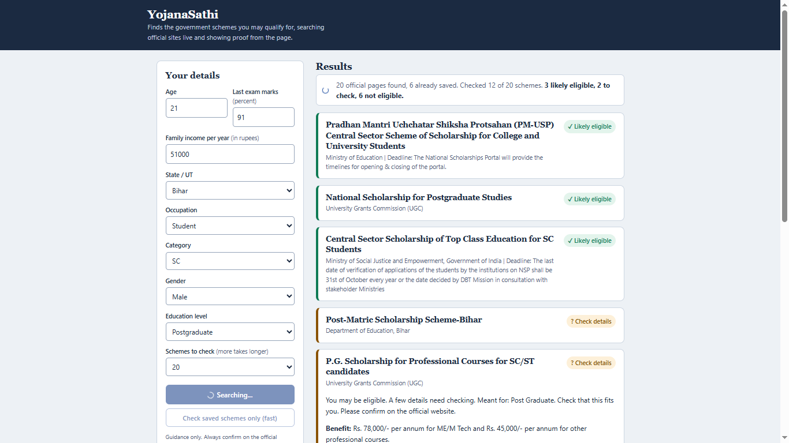

<html>

<body>
<h1>YojanaSathi: a personal government scheme finder</h1>

<h3>Team: <b>Professional Procrastinators</b> | Hackathon: <b>HackIIITD 2026</b> | Built with: <b>TinyFish Search, Fetch and Web Agent</b></h3>

<h5><u>The problem</u></h5>

India has thousands of government schemes across central and state portals. Each one has its own eligibility rules, documents and deadlines, spread over different websites in different formats. People often don’t know a scheme exists, can’t tell whether they qualify, or don’t know what to bring. Information is scattered, so benefits go unclaimed.

<h5>What YojanaSathi does</h5>

A person enters a few details: age, state, income, occupation, category, gender, education and marks. YojanaSathi then:

Searches live across official government sites (gov.in and nic.in) for schemes that could apply to that profile.
Reads each scheme page and extracts the eligibility rules, benefits, deadline and required documents.
Checks the rules against the person’s profile and labels each scheme Likely eligible, Check details or Not eligible, with the reason for each rule.
Shows proof. Each rule is backed by a quote from the official page, and a green seal appears only if that quote matches the fetched page word for word.
Gives a document checklist and a link to the official page, so the person knows exactly what to gather and where to apply.

Results appear on screen one by one as each scheme is read, with a live progress counter.

 

</body>
</html>
